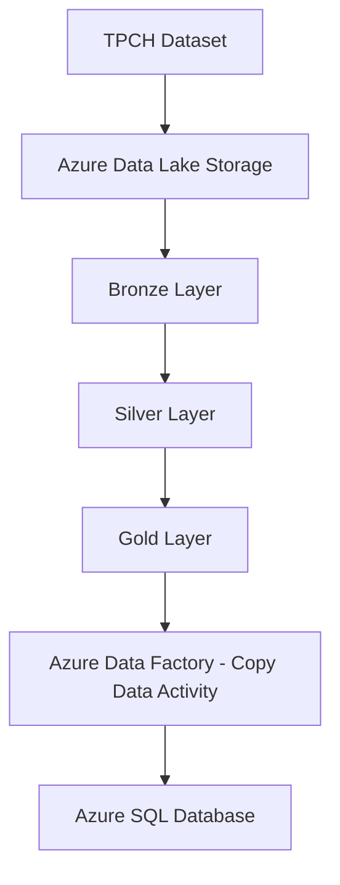

# TPCH Data Engineering Project

## Project Overview
This project demonstrates a data engineering pipeline using the
TPCH dataset. The data is processed using Azure Databricks,
PySpark and Delta Lake, following the Medallion Architecture.

The transformed Gold data is transferred to Azure SQL Database
using Azure Data Factory (ADF) Copy Data activity.

## Technologies Used
- Azure Databricks
- Apache Spark / PySpark
- Delta Lake
- Azure Data Factory (ADF)
- Azure Data Lake Storage
- Azure SQL Database
- SQL

## Architecture
The project follows the Medallion Architecture:

- Bronze Layer: Raw data ingestion
- Silver Layer: Data cleaning and transformation
- Gold Layer: Business-ready data

Gold data is transferred to Azure SQL Database using
Azure Data Factory.

## Project Architecture

## Project Workflow
1. Ingest TPCH source data.
2. Store raw data in the Bronze layer.
3. Clean and transform data in the Silver layer.
4. Perform business transformations in the Gold layer.
5. Create ODS tables and reporting views.
6. Transfer Gold data to Azure SQL Database using ADF.

### 1. Data Ingestion
The TPCH dataset is used as the source data for the project.

### 2. Bronze Layer
Raw data is ingested and stored in the Bronze layer.

### 3. Silver Layer
Data cleaning and transformation activities are performed using PySpark.

### 4. Gold Layer
Business-level transformations are performed to prepare data for reporting.

### 5. Azure SQL Database
Gold data is transferred to Azure SQL Database using Azure Data Factory Copy Data activity.

### 6. SQL Reporting
ODS tables and RPT views are created for structured data storage and reporting.

## Data Model
- ODS tables: 6
- Reporting views: 2

## Key Learnings
- Data ingestion and ETL processes
- Data transformation using PySpark
- Medallion Architecture
- Delta Lake
- SQL joins and views
- Azure Data Factory pipelines
- Data movement from Databricks to Azure SQL

## Author
Swathi
